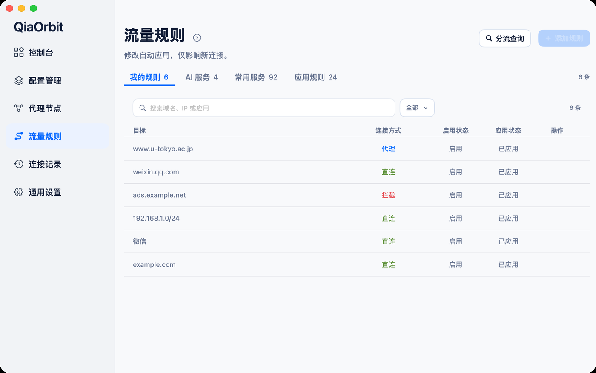

# &nbsp; 

**A native macOS client for proxy connections and traffic routing**

Import a profile, route traffic by website or app, and see how each connection was handled.

&nbsp; 

macOS 14+ · Apple silicon&nbsp; &nbsp; · [简体中文](README.zh-CN.md)

## Core features

| Feature | What you can do |
| --- | --- |
| **Rule-based routing** | Set direct, proxy, or block rules for domains, IP addresses, or apps. |
| **Two connection methods** | Choose System Proxy or the virtual network interface (TUN). |
| **Node testing and switching** | Compare latency and stability, and check whether common AI services are reachable. |
| **Connection history** | See the actual route and matching rule. Search, filter, and export records to CSV. |

## See where each connection went

Search Connection History by app or destination to see whether a connection went direct, used a proxy, or was blocked, and which rule matched.

View the traffic rules screen

## App specifications

| Item | Details |
| --- | --- |
| Interface | Native macOS interface built with SwiftUI |
| Core | Mihomo (Clash.Meta) |
| Signing and notarization | Developer ID signing and Apple notarization |

## Get started

1. Open the DMG and drag QiaOrbit into Applications.
2. Import a ClashMeta / Mihomo subscription or local configuration, then choose a node. QiaOrbit does not provide nodes or subscriptions.
3. Enable System Proxy or TUN as needed. If you enable TUN, approve the network extension when macOS prompts you.

When should I use System Proxy or TUN?

Use System Proxy for apps that follow macOS proxy settings. Choose TUN to route system traffic after you approve the network extension.

Where are my profiles and connection history stored?

Profiles, rules, and connection history are stored on your Mac in `~/Library/Application Support/QiaOrbit`.

[Official website](https://minovra.app/products/qiaorbit) · [Release notes](https://github.com/ovralab/QiaOrbit/releases) · [Rules repository](https://github.com/ovralab/Qiaorbit-rules) · [Support](mailto:support@minovra.app)

© 2026 Minovra
