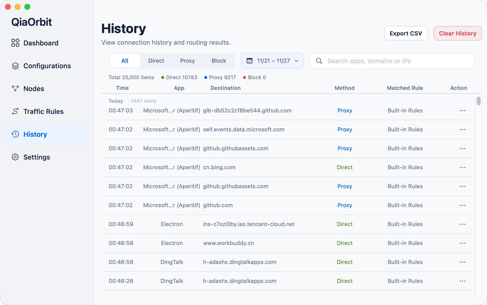

# QiaOrbit

**Route traffic on your Mac. See where each connection went.**

QiaOrbit brings profile management, routing rules, and connection diagnostics into one macOS app.

macOS 14 or later · Apple silicon | [简体中文](README.zh-CN.md)

## See what your rules did

Open Connection History to see whether traffic went direct, used a proxy, or was blocked, along with the rule that matched.

**Configure routing**
Import a ClashMeta / Mihomo subscription or a local profile. Set rules for domains, IP addresses, or apps.

**Choose how to connect**
Use System Proxy for apps that follow macOS proxy settings, or enable the virtual network interface (TUN) for system traffic.

**Compare nodes**
Compare latency and stability, then check DNS and node connectivity from the dashboard.

## Get started

1. Download the DMG and drag QiaOrbit into Applications.
2. Open QiaOrbit, import a profile, and select a node.
3. If you enable TUN, approve the network extension when macOS prompts you.

QiaOrbit is a commercial app. Bring your own profiles, nodes, or subscriptions. [Contact support](mailto:support@minovra.app).
