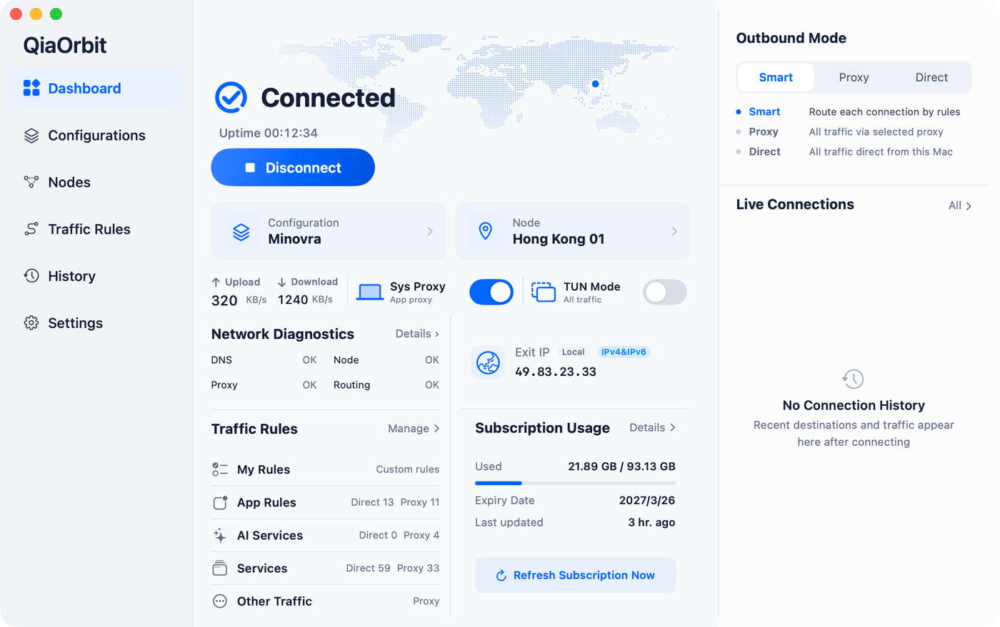
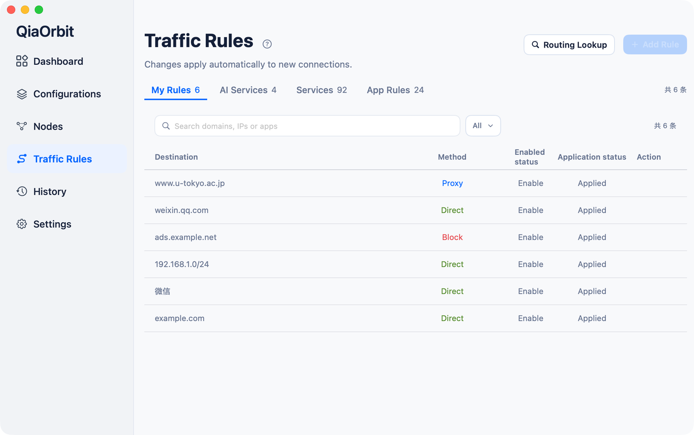

# &nbsp; 

**Native macOS proxy and routing client**

Import a configuration, route by website or app, and see where each connection actually went.

&nbsp; 

macOS 14+ · Apple silicon&nbsp; &nbsp; · <a href="README.zh-CN.md"><  align="middle" alt="简体中文"></a>

## Core features

| Feature | What it does |
| --- | --- |
| **Rule-based routing** | Set direct, proxy, or block per domain, IP address, or app. |
| **Two ways to take over traffic** | Use System Proxy or the virtual network interface (TUN), depending on your needs. |
| **Node testing and switching** | Compare latency and stability, and check availability of common AI services. |
| **Connection history** | See the actual egress path and the rule that matched; search, filter, and export to CSV. |

## See where every connection went

In **History**, search by app or destination to see whether traffic went direct, through the proxy, or was blocked — and which rule matched.

View the traffic rules screen

## App specifications

| Item | Details |
| --- | --- |
| Interface | Native macOS interface built with SwiftUI |
| Core | Mihomo (Clash.Meta) |
| Signing | Developer ID signing and Apple notarization |

## Get started

1. Open the DMG and drag QiaOrbit into Applications.
2. Import a ClashMeta / Mihomo subscription or local configuration, then select a node. QiaOrbit does not provide nodes or subscriptions.
3. Enable System Proxy or TUN as needed. The first time you enable TUN, approve the network extension when macOS asks.

System Proxy or TUN — which one?

System Proxy covers apps that follow macOS proxy settings. TUN is for cases where system-wide traffic must be captured, and requires approving the network extension first.

Where are my configuration and connection history stored?

Configuration, rules, and connection history are stored locally in `~/Library/Application Support/QiaOrbit`.

[Official website](https://minovra.app/products/qiaorbit) · [Release notes](https://github.com/ovralab/QiaOrbit/releases) · [Rules repository](https://github.com/ovralab/Qiaorbit-rules) · [Support](https://minovra.app/support/new)

© 2026 Minovra
