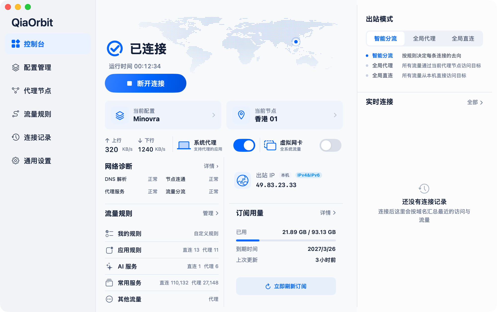
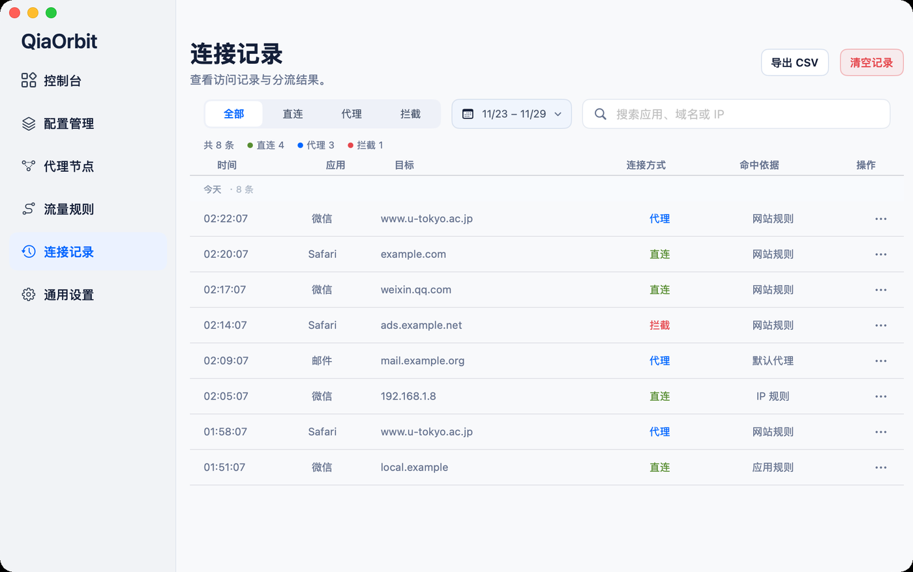

#  QiaOrbit

### 连接更简单，流量有去向。

为 macOS 打造的原生代理客户端，把配置、分流和诊断放进同一个窗口。

&nbsp; 

  
  
  
  
  

最新版 **v1.0.13** · 78 MB DMG · [English](README.md)

---

## 为什么选择 QiaOrbit

| | |
|---|---|
| **规则看得懂** | 网站、IP、应用三类规则，直连 / 代理 / 拦截三种动作。每条连接命中了哪条规则，都能在记录里查到。 |
| **两种接管方式** | 「系统代理」适合遵循 macOS 代理设置的应用；「虚拟网卡」通过已签名的系统扩展接管全部流量。 |
| **先诊断，再判断** | 切节点前先看延迟与稳定性；出问题时还有 DNS、节点、代理、分流四项检查。 |

---

## 功能一览

| 模块 | 说明 |
|---|---|
| **分流** | 我的规则、应用规则、AI 服务、常用服务、其他流量五层。改规则热生效，不用断开连接。 |
| **配置** | 支持 ClashMeta / Mihomo 订阅与本地 YAML、链接导入、二维码导入、按配置自动更新、用量与到期提醒。 |
| **节点** | 按地区分组，延迟分三档着色，稳定性多次采样，另有 AI 可达性一列。 |
| **记录** | 每次连接都记录应用、目标、命中规则与连接方式；支持导出 CSV 与保留天数设置。 |
| **隐私** | 无需注册账号；配置与记录只保存在本机；诊断不会上传你的配置。 |

---

## 规则到底生效了没有

左：规则编辑，直连 / 代理 / 拦截。右：连接记录，逐条显示命中的规则。

  
  

---

## 技术实现

| 层 | 实现 |
|---|---|
| **界面** | SwiftUI，macOS 14+，浅色设计系统，尺寸与颜色统一走 token |
| **内核** | mihomo（Clash Meta）：虚拟网卡模式下进程内嵌；系统代理模式下作为受管子进程运行 |
| **隧道** | `NEPacketTunnelProvider` 系统扩展，数据包通过 C ABI 交给内核 |
| **签名** | Developer ID + Hardened Runtime + 安全时间戳，Apple 公证，Sparkle EdDSA 更新校验 |

---

## 开始使用

1. 打开 DMG，把 **QiaOrbit** 拖到「应用程序」。
2. 导入 ClashMeta / Mihomo 订阅或本地配置，选一个节点。
3. 按需打开「系统代理」或「虚拟网卡」。首次开虚拟网卡时，在系统弹窗里允许网络扩展。
4. 到「流量规则」里调整分流，改完立即生效，不需要重连。

> **环境要求**：macOS 14.0 或更高 · Apple 芯片 · 虚拟网卡需在「系统设置 → 通用 → 登录项与扩展 → 网络扩展」中允许 QiaOrbit。

---

## 常见问题

QiaOrbit 提供节点或订阅吗？

不提供。它是客户端，需要你自己准备 ClashMeta / Mihomo 配置、订阅或节点链接。

系统代理和虚拟网卡怎么选？

系统代理只覆盖遵循 macOS 代理设置的应用；虚拟网卡接管全部流量，包括不认系统代理的应用，但需要在系统设置里允许网络扩展。

我的数据存在哪里？

配置、规则和连接记录都在 `~/Library/Application Support/QiaOrbit`。没有账号体系，也不会上传云端。

这个仓库是开源的吗？

应用源码在私有仓库维护；本仓库提供发布说明、下载与素材。第三方组件与许可证随 App 包提供。

---

## 相关链接

- 官方网站 · <https://minovra.app/products/qiaorbit>
- 更新日志 · [Releases](https://github.com/ovralab/QiaOrbit/releases)
- 规则仓库 · [ovralab/Qiaorbit-rules](https://github.com/ovralab/Qiaorbit-rules)
- 支持邮箱 · <support@minovra.app>

---

© 2026 Minovra · 隐私政策 · 服务条款 · 第三方声明
